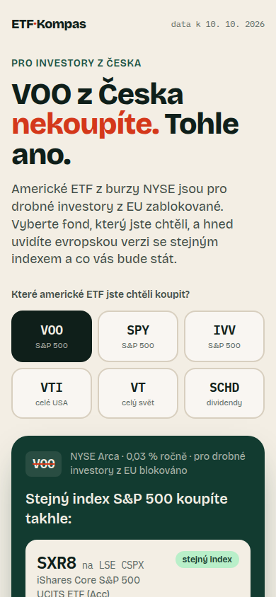
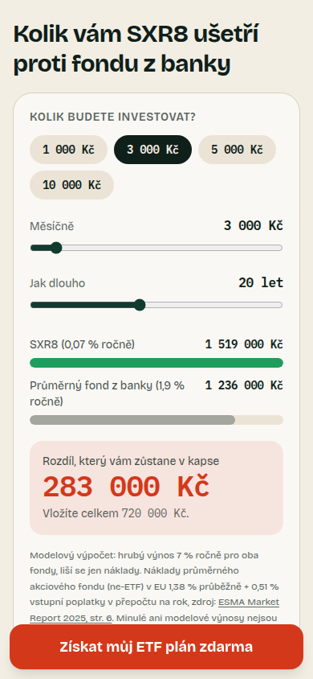
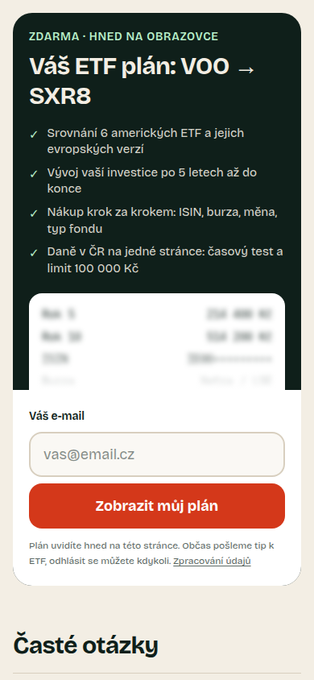
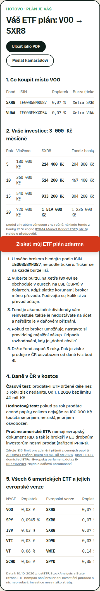

# ETF Kompas – lead-gen landing page

[](https://github.com/sky1407/etf-kompas/actions/workflows/ci.yml)

**Live:** https://etf-kompas.vercel.app · ad A: [`/?ad=fees`](https://etf-kompas.vercel.app/?ad=fees) · ad B: [`/?ad=voo`](https://etf-kompas.vercel.app/?ad=voo)
**Ads:** [`ads/`](ads/) (two creatives + copy) · **AI log:** [`ai-log/`](ai-log/)

A mobile-first landing page comparing NYSE-listed ETFs for Czech retail investors that turns paid social traffic into email leads.

| Hero (ad B) | Calculator | Email gate | Plan after submit |
|---|---|---|---|
|  |  |  |  |

---

## 1. The idea in one sentence

Czech retail investors who want **VOO / SPY / VTI** can't buy them – EU PRIIPs rules require a KID document that US issuers don't publish, so EU brokers block them – and most people find that out only when the broker search comes up empty. The page answers the question they actually have ("so what do I buy instead?") in one tap, shows the cost difference in CZK, and offers a personal buying plan in exchange for an email.

This angle is deliberate: a generic "compare ETFs" page competes with justETF and every finfluencer; a page that solves a concrete, frustrating, Czech-specific problem has a reason to exist and a reason to leave an email.

## 2. Target group

- **Who:** Czech, 25–40, on a phone, coming from an Instagram/Facebook ad. Invests (or is about to) 1 000–10 000 CZK a month via XTB, Trading 212, Revolut, Portu or a bank.
- **What they know:** they've heard "just buy the S&P 500 / VOO" from YouTube or Reddit, know a few tickers, don't know UCITS, ISINs, domicile or Czech tax rules.
- **What they feel:** mild confusion ("why can't I find VOO?") and distrust of banks' fees. They give the page a few seconds.
- **Not targeted:** complete beginners (no ticker in mind – ad A partly covers them) and professionals (who can buy US ETFs).

## 3. Value exchange and when we ask

| | |
|---|---|
| **Free, before any form** | The UCITS counterpart of the chosen ETF (ticker, ISIN with copy button, TER, size, same/similar index) and the fee calculator with the CZK result. |
| **For the email** | "Váš ETF plán": both counterparts with exchanges and currencies, year-by-year projection, a 5-step buying checklist, Czech taxes on one screen (3-year time test, 100 000 CZK rule), the full 6-fund comparison. |
| **When we ask** | Right after the calculator shows a big CZK number – the moment of highest motivation. The visitor already got real value, so the ask feels fair (reciprocity), and a blurred preview with *their* numbers shows exactly what's behind the gate. |
| **Form** | One field (email). Honeypot instead of captcha. Consent is a one-line notice + link, not a checkbox. |
| **After submit** | The plan renders **instantly on the page** (no "check your inbox" dead end), with "Save as PDF" and "Send to a friend". A copy goes by email when Resend is configured. |

Why instant delivery: a lead magnet that only arrives by email loses people to typos, spam folders and delay; showing it immediately makes the promise true at the moment of conversion and makes the email a bonus, not a hostage.

## 4. Section order and why

1. **Hero = the ad's promise, word for word.** `?ad=fees` → "O 283 000 Kč přijdete ve fondu z banky." `?ad=voo` → "VOO z Česka nekoupíte. Tohle ano." Message match is the cheapest conversion lever; the variant is server-rendered, so there's no flicker.
2. **Fund picker inside the first screen.** One tap, no typing. A tap is the first micro-commitment and an analytics event.
3. **Answer card.** Immediate payoff of the ad's promise: the counterpart, ISIN, fee, and the source. Followed by a CTA "Chci celý plán…".
4. **Fee calculator.** Turns an abstract 0.07 % vs 1.9 % into a CZK number for *their* monthly amount – the emotional peak.
5. **Email gate.** Placed exactly after the peak.
6. **FAQ.** Handles objections only for those who scroll past the gate (is the EU version worse? taxes? who are you?), ending with another CTA.
7. **Sources and disclaimer.** Trust for the skeptics, legal hygiene for the advertiser.

A sticky CTA appears on mobile only when the gate is off-screen (and never after conversion).

## 5. Data and sources

Every number on the page has a source and an access date (10 Oct 2026), shown next to it on the page:

| Data | Source |
|---|---|
| US ETFs (VOO, IVV, VTI, VT, SCHD): TER, AUM, index, exchange = NYSE Arca | [StockAnalysis](https://stockanalysis.com/etf/voo/) (close 9 Oct 2026) |
| SPY TER 0.0945 % | [State Street SSGA](https://www.ssga.com/us/en/intermediary/etfs/state-street-spdr-sp-500-etf-trust-spy) |
| UCITS counterparts (CSPX/SXR8, VUAA, XD9U, VWCE, FWIA, SPYD): ISIN, TER, AUM, tickers, distribution | [justETF](https://www.justetf.com/en/etf-profile.html?isin=IE00B5BMR087) |
| Average non-ETF equity fund cost 1.9 % p.a. (1.38 % ongoing + 0.51 % entry fees) | [ESMA Market Report on Costs and Performance of EU Retail Investment Products 2025, p. 6](https://www.esma.europa.eu/sites/default/files/2026-03/ESMA50-1949966494-4065_Market_Report_-_Costs_and_Performance_of_EU_Retail_Investment_Products.pdf) |
| Why US ETFs are blocked (PRIIPs/KID) | [justETF](https://www.justetf.com/en/news/etf/us-domiciled-etfs.html), [European Parliament E-004745/2021](https://www.europarl.europa.eu/doceo/document/E-9-2021-004745_EN.html) |
| Czech tax: 3-year time test, 100 000 CZK rule, 40 M CZK cap removed from 2026 | [E15](https://www.e15.cz/finexpert/danove-priznani/od-ledna-plati-novy-limit-pro-zdaneni-prijmu-z-obchodovani-s-cennymi-papiry-a-podily-v-obchodnich-korporacich-1423019), [ARROWS](https://arws.cz/novinky-v-arrows/zruseni-limitu-40-milionu-kc-pri-prodeji-podilu-a-cennych-papiru) |

Data lives in typed files: [`src/data/funds.ts`](src/data/funds.ts), [`src/data/facts.ts`](src/data/facts.ts). The projection model ([`src/lib/projection.ts`](src/lib/projection.ts), tested in [`tests/`](tests/)) uses a 7 % gross return for both funds, so the only difference is cost – stated on the page as a model, not a forecast.

**Honesty choices:** QQQ was left out because it trades on Nasdaq, not NYSE. VTI, VT and SCHD have no UCITS fund on the exact same index, so the page labels their counterparts "similar index" and explains the difference instead of pretending they're twins. The page also admits CSPX costs 0.04 pp more than VOO.

## 6. Measurement – the full journey

PostHog (EU cloud), **cookieless** (`persistence: "memory"`) → no cookie banner, which on mobile would eat the first screen. Autocapture and session recording are off; events are explicit:

| Step | Event | Properties |
|---|---|---|
| Arrival | `landing_view` | super-properties on every event: `variant`, `utm_*` |
| Picked a fund | `fund_selected` | `us_ticker` |
| Copied ISIN | `isin_copied` | `isin` |
| Used calculator | `calculator_used` | first interaction only |
| Saw the gate | `gate_viewed` | IntersectionObserver ≥ 40 % |
| CTA clicks | `cta_clicked` | `cta`: `twin_card` / `sticky` / `share` |
| Focused email | `email_focused` | |
| Submitted | `lead_submitted` → `lead_succeeded` / `lead_failed` | `reason` on failure |
| Saved PDF | `pdf_downloaded` | |
| Scroll | `scroll_depth` | 25 / 50 / 75 / 100 |

Main funnel in PostHog: `landing_view → fund_selected → calculator_used → gate_viewed → email_focused → lead_succeeded`, broken down by `variant` (= which ad) and `utm_content`. Server-side truth is the `leads` table (Neon Postgres), which stores `variant` and UTM per lead, so ad-level CPL can be computed even if a visitor blocks analytics.

Note: posthog-js drops events from headless browsers (`HeadlessChrome` UA) – automated tests therefore don't pollute the data; the E2E check of event delivery was done with a mobile Safari UA.

## 7. Expected conversion

**Base case: 6 % of landing visitors leave an email** (range 3–10 %).

- Benchmark: Unbounce's 2024 report puts **investing** landing pages at a median of **3.9 %** ([source](https://unbounce.com/conversion-benchmark-report/finance-insurance-conversion-rate/)), with Instagram as the strongest paid-social channel in finance.
- Why above median: one-field form, value delivered before the ask, exact message match with the ad, specific problem (not "subscribe to our newsletter"), fast page (Lighthouse mobile performance 98, LCP 2.2 s, CLS 0).
- Why not higher: cold paid-social traffic, a 3-second attention span, and the fact that the free part already answers the main question (some visitors will take the ISIN and leave – that's the price of being genuinely useful, and the ISIN-copy event lets us measure it).

Assumed step rates for the funnel (to be replaced with real data after ~1 000 visits): view 100 % → fund selected 55 % → calculator used 35 % → gate viewed 30 % → email focused 10 % → lead 6 %.

## 8. A/B test hypotheses (by expected impact)

1. **Ad angle × hero (VOO vs fees) – highest impact.** *Because the VOO angle addresses a concrete, surprising problem for people who already have intent, we expect a higher click-through and visit→lead rate than the loss-aversion fee angle, which reaches more people but colder ones.* Already wired: `?ad=voo|fees` + `variant` on every event and lead. Metric: cost per lead (not CTR alone).
2. **Gate position: after the calculator (now) vs right after the answer card.** *Moving the ask earlier exposes it to the majority of visitors who never use the calculator; we expect more leads at a slightly lower intent level.* Metric: leads per visitor and later email engagement.
3. **Gate offer framing: "Váš ETF plán" vs "Hlídací pes poplatků" (email alert when a cheaper counterpart appears or TER changes).** *An ongoing benefit gives a reason to want emails, which may raise conversion and later open rates.* Metric: visit→lead and 30-day open rate.

## 9. Ads

Two creatives for Meta feed (1080×1350) with primary text, headline, description and UTM links: [`ads/README.md`](ads/README.md).

- **A – Fees:** "283 000 Kč – O tolik přijdete ve fondu z banky." Loss aversion, broad audience.
- **B – VOO:** "VOO z Česka nekoupíte. Tohle ano." Curiosity + insider knowledge, audience that already knows tickers.

## 10. Stack and running locally

Next.js 15 (App Router) · TypeScript · Tailwind CSS 4 · zod · Neon Postgres (via Vercel Marketplace) · PostHog EU · optional Resend · Vercel.

```bash
npm install
vercel env pull .env.local    # DATABASE_URL, IP_HASH_SALT, NEXT_PUBLIC_POSTHOG_KEY (+ optional RESEND_*)
npm run db:migrate            # creates the leads table (db/schema.sql)
npm run dev
npm test && npm run lint && npm run build
npx playwright install chromium && npm run test:e2e   # API + browser tests, see section 11
```

**Lead API** (`POST /api/lead`): body size cap, zod validation (email, whitelisted ticker, numeric ranges, UTM length), honeypot, per-IP rate limit (5 / 10 min, IP stored only as a salted SHA-256 hash), upsert on email, parameterized SQL. Security headers are set in `next.config.ts`. The page is `noindex` because it's an ad landing page (Lighthouse SEO 60 for that reason only; performance 98, accessibility 96 → contrast fixed afterwards, best practices 100).

## 11. Testing

| Layer | Command | What it checks |
|---|---|---|
| Unit | `npm test` | Fee projection model ([`tests/projection.test.ts`](tests/projection.test.ts)): zero-return identity, invalid input, reference value 283 000 CZK. |
| Static | `npx tsc --noEmit`, `npm run lint`, `npm run build` | Types, ESLint, production build. Run in [CI](.github/workflows/ci.yml) on every push. |
| API | `npm run test:e2e` → [`tests/e2e/api.spec.ts`](tests/e2e/api.spec.ts) | Valid lead stored; same email in different case updates **one** row and keeps first-touch UTM; IP stored only as a 64-char hash; rejects invalid email, SQL-injection string, ticker outside whitelist, out-of-range amount, unknown UTM key, malformed JSON (400) and oversize body (413); honeypot returns 200 but stores nothing; 6th request from one IP in 10 min gets 429. |
| Browser | `npm run test:e2e` → [`tests/e2e/landing.spec.ts`](tests/e2e/landing.spec.ts) | 390×844 mobile viewport, Chromium: hero matches each ad; all 6 NYSE funds map to the right UCITS counterpart; full funnel (fund → calculator = exact model value → empty-email error → submit → plan with ISIN and tax rules); no horizontal scroll; sticky CTA hidden after conversion; zero console errors; privacy page. |

The E2E suite starts the app itself (or reuses a running one on `:3000`; `E2E_BASE_URL` points it at a deployment), needs `DATABASE_URL` for the DB assertions, and deletes every `e2e-test*` lead afterwards. It is not run in CI because it writes to the real database. Last local run: **16 passed**. To prove the tests can fail, the expected calculator value was changed once to `1638101Kč` – the run failed with `Received: "1638100Kč"` – and reverted.

Analytics delivery was checked separately: posthog-js drops `HeadlessChrome` traffic, so a run with a mobile Safari user agent confirmed that `/e/` batches reach `eu.i.posthog.com`. Lighthouse (mobile) was run against production.

## 12. Decisions on unclear points

- **"NYSE ETFs" for a Czech investor** – taken literally, a comparison of NYSE ETFs would recommend products the visitor can't buy. I kept NYSE funds as the *entry point* (that's what people search for) and made their EU-buyable counterparts the answer. This turns the brief's constraint into the page's hook.
- **Language** – the page and ads are in Czech (target group); README and code in English for the reviewer and GitHub.
- **Comparison baseline for the calculator** – comparing ETFs among themselves gives differences of a few thousand CZK; the real decision for this audience is "ETF vs. the fund my bank sells me". I used the ESMA EU average for non-ETF equity funds rather than naming a specific bank's fund (fees differ by share class and change; naming one would be unfair and hard to keep current).
- **Lead magnet delivered on page** – see section 3.
- **No cookie banner** – cookieless analytics instead; a banner on the first mobile screen would cost more conversions than it buys data.

## 13. What's missing / before launching ads tomorrow

- **Operator identity** in the privacy notice and footer (company name, ID, contact) – required before running ads; I don't know who the advertiser is.
- **Email delivery:** Resend works only with a verified sending domain; without it the email copy is skipped (the API returns `emailed: false`, and the form copy no longer promises an email copy – it is switched by whether `RESEND_*` is configured). One-click unsubscribe and a nurture sequence are not built; unsubscribing is by reply.
- **Meta Pixel / Conversions API** for ad optimization – not added (would need a consent banner; recommended server-side CAPI from `/api/lead`).
- **PostHog funnel dashboard** has to be created in the PostHog UI (events are flowing; definition in section 6).
- Data is a snapshot (10 Oct 2026); a scheduled refresh from issuer pages isn't implemented.
- `npm audit` reports a high-severity `postcss` advisory inside Next's own bundled copy (build-time only, not reachable at runtime); fixing it requires a Next major upgrade.

## 14. How I worked with AI

The whole project was built in one Claude Code session (Claude Opus 5.5), exported to [`ai-log/`](ai-log/). I used no sub-agents: the task is sequential (data → model → UI → API → deploy) and a single agent with the full context made fewer consistency errors than parallel workers would.

**Instructions the agent had**
- Global rules from my `CLAUDE.md`: answer in Slovak; no code comments; strict typing and explicit error handling; small steps (max 2–3 files at once); run lint/build/tests after every change; **propose alternatives with pros/cons and let me choose before coding**; commits in English without AI signatures.
- The brief, plus my request to write a plan first. The agent proposed the concept and asked me three decisions (stack: Next.js vs Astro; storage/analytics: PostHog + Neon vs Supabase vs GA4; delivery: instant on page vs email-only). I picked the recommended options.
- Secrets policy: I never paste keys into the chat; I add them in the Vercel dashboard, and the agent only checked their presence/prefix without printing values.

**How I checked the output**
- Every fund number was fetched from a live source (justETF, StockAnalysis, SSGA, ESMA PDF) rather than written from model memory; I asked for the source URL to be stored next to each value.
- Unit tests for the fee model; lint + type-check + production build after each step.
- Headless-browser runs on a 390 px viewport after each UI change: screenshots, console errors, horizontal overflow, and a scripted funnel (pick fund → calculator → submit) against the live deployment, followed by a check of the row in Postgres (then deleted).
- Lighthouse mobile audit.

**Where the AI got it wrong (and how it was caught)**
1. **Fake numbers in the blurred preview** – it first rendered the gate's teaser with arbitrary multipliers (`monthly * 69`). Caught on review; replaced with the real projection so even the blurred text is true.
2. **Misleading headline** – "283 000 Kč zaplatíte navíc" (you pay extra); the number is lost return, not fees paid. Rewritten to "O 283 000 Kč přijdete".
3. **Wrong validation order** – the API checked the DB connection before validating input, so a bad email returned 503 instead of 400. Found by curl tests; reordered.
4. **False test result** – the E2E script read `[role=alert]`, which matched Next.js's hidden route announcer, and reported an empty error. Fixed by scoping the selector to the form.
5. **Stale server during QA** – a `pkill` pattern killed the agent's own shell and an old server kept serving a previous build (400s on JS chunks). Diagnosed from the server log; afterwards processes were stopped by PID.
6. **"Tracking doesn't work"** – the first production check showed no events. Two real causes: the PostHog key field contained the onboarding command (`npx -y @posthog/wizard…`) instead of the `phc_` key – spotted in the 404 URL – and posthog-js silently drops `HeadlessChrome` traffic. Verified with a mobile Safari UA.
7. **Contrast** – the brand orange `#ff4f2e` failed WCAG AA (2.8:1); Lighthouse caught it, darkened to `#d4381a` (4.8:1 with white).
8. **Mobile tables** – the first version of the plan used 5-column tables that overflowed at 390 px, and the sticky CTA stayed visible over the delivered plan; both found on screenshots and fixed.
9. **Facts from memory** – the first fund shortlist was drafted from model knowledge and included QQQ, which trades on Nasdaq, not NYSE. Caught before data collection; from then on every value was fetched from a source instead of recalled.
10. **Promises the product didn't keep** – the form said "kopii pošleme e-mailem" and "odhlásíte se jedním klikem" while no email provider or unsubscribe link existed. Found during the final copy review; the email line now depends on the actual configuration and the unsubscribe line says what is true.
