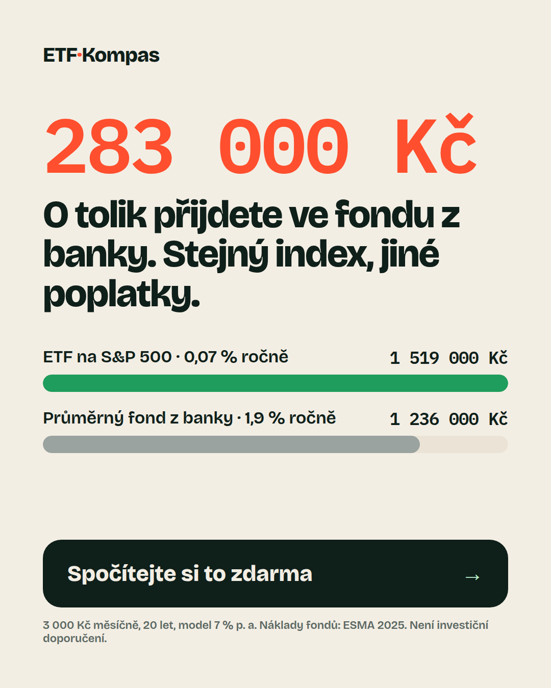
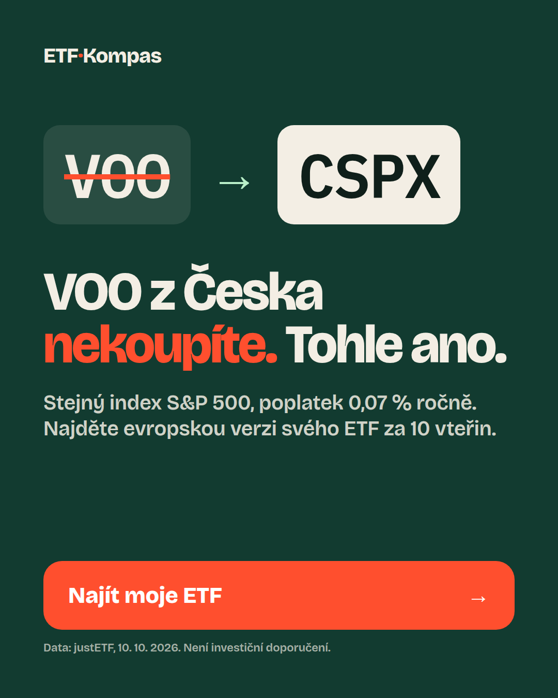

# Ad variants (Meta feed / Instagram, 1080×1350)

Both ads land on the same page; the `ad` query parameter switches the hero so the first screen repeats the ad's promise word for word.

## A – "Fees" (loss aversion)

| Field | Copy (Czech) |
|---|---|
| Primary text | Při 3 000 Kč měsíčně vás průměrný fond z banky stojí za 20 let zhruba 283 000 Kč na poplatcích a ušlém výnosu. Stejný index S&P 500 seženete v ETF za 0,07 % ročně. Spočítejte si to na svých číslech – zdarma, bez registrace. |
| Headline | O 283 000 Kč přijdete ve fondu z banky |
| Description | Kalkulačka poplatků v korunách + plán nákupu ETF |
| CTA button | Zjistit více |
| URL | `https://<domain>/?ad=fees&utm_source=meta&utm_medium=paid_social&utm_campaign=etf_kompas&utm_content=a_fees` |

Audience: CZ, 25–44, interests in investing / XTB / Trading 212 / Revolut / personal finance; placements: Instagram + Facebook feed and Stories.

## B – "VOO" (curiosity + insider knowledge)

| Field | Copy (Czech) |
|---|---|
| Primary text | Chtěli jste koupit VOO nebo SPY a broker vám ho nenabídne? Nejde o chybu – americké ETF jsou pro drobné investory z EU zablokované. Ukážeme vám evropskou verzi se stejným indexem, poplatkem a ISIN. Za 10 vteřin. |
| Headline | VOO z Česka nekoupíte. Tohle ano. |
| Description | 6 amerických ETF a jejich evropské náhrady |
| CTA button | Zjistit více |
| URL | `https://<domain>/?ad=voo&utm_source=meta&utm_medium=paid_social&utm_campaign=etf_kompas&utm_content=b_voo` |

Audience: same as A, plus interest "Exchange-traded fund" / "Vanguard" / "S&P 500" (people who already know the tickers).

## Numbers in the ads

All figures come from the same model as the page (`src/lib/projection.ts`): 3 000 CZK/month, 20 years, 7 % gross return p.a.; ETF cost 0.07 % (CSPX, justETF 10 Oct 2026) vs. 1.9 % total annual cost of an average non-ETF equity UCITS (ESMA Market Report 2025, p. 6).

Sources are in `src/`; the ads are rendered from `ads/src/*.html`.
